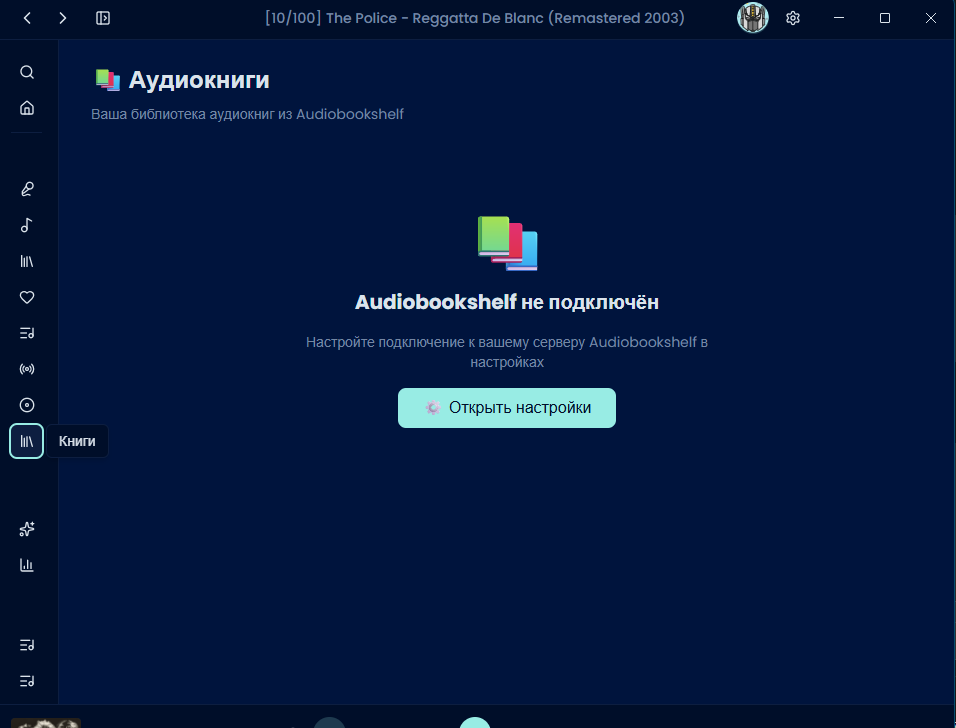

# 🎵 KumaFlow

**Современный десктоп-плеер для Navidrome / Subsonic с умной «Моей волной», Vibe Similarity и опциональным мозгом**

[](https://github.com/mrSaT13/kumaflow/releases/latest)
[](https://github.com/mrSaT13/kumaflow/releases)
[](https://github.com/mrSaT13/kumaflow/releases/latest)
[](LICENSE.txt)


> Глубоко переработанный форк [Aonsoku](https://github.com/victoralvesf/aonsoku) — с новой «Моей волной», переработанной Библиотекой, закреплёнными артистами, Remote Control и связкой с мозгом.

---

## 🧩 Экосистема KumaFlow

| Репозиторий | Что это | Ссылка |
|---|---|---|
| 🎵 **KumaFlow Player** | Этот репозиторий — десктоп-плеер (Windows · macOS · Linux) + web-режим. Локальный ML, Vibe Similarity, Smart Auto-DJ, книги, Remote Control | [github.com/mrSaT13/kumaflow](https://github.com/mrSaT13/kumaflow) |
| 🧠 **KumaFlow Brain** | Опциональный серверный мозг: sonic-анализ (librosa), CLAP-поиск по смыслу, «Моя волна» per-user, daily-плейлисты, тексты, бэкапы | [github.com/mrSaT13/kumaflow-brain](https://github.com/mrSaT13/kumaflow-brain) |
| 📱 **Mobile** | Мобильный клиент (отдельно, см. релизы с префиксом `MC_*` — десктоп их не касается) | — |

**Как это работает вместе:**

```
Navidrome :4533 (музыка)
   ├─→ KumaFlow Player (этот репо) — играет, показывает, управляет
   └─→ KumaFlow Brain :8000 (опционально) — анализирует, рекомендует, ведёт волну
            ↑ плеер шлёт события/лайки, забирает волну, daily-микс, handoff
```

Без мозга плеер полностью работает на локальном ML. С мозгом — «Моя волна» становится умнее (CLAP + скип-риск + UCB-бандит), появляется общая очередь между устройствами и «KumaFlow Mix».

---

## 🆕 Что нового в 1.12.0

> Первое крупное обновление после `v1.6.6`. Полный список — в [CHANGES.md](./CHANGES.md) и на [странице релиза](https://github.com/mrSaT13/kumaflow/releases/tag/v1.12.0).

- 🌊 **Новая «Моя волна»** — живая капля в цвете обложки/жанра (3 слоя, переезд ~0.7с), 10 эффектов настроений по жанрам (огонь, warp, mist, sparkle, bounce…), лучи вместо полосок. Тумблеры: Настройки → Внешний вид
- 📚 **Новая «Библиотека»** — разделы-навигация: вся коллекция (исполнители/треки/альбомы), радио, книги (если подключён Audiobookshelf), локальная, «Для вас». Любимое, плейлисты, дизлайки. Кэш: мгновенный показ + обновление в фоне
- 📌 **Закреплённые артисты** — пины до 20, круглые аватары в сайдбаре
- 🎤 **Модалка «Исполнители» как в мобилке** — фото подтягиваются поиском по имени (чинит склейки «A/B»), тап сразу ведёт на страницу артиста
- 🧹 **Чистый сайдбар по умолчанию** — Библиотека / Плейлисты / «Для вас» скрыты, всё живёт в `/library`. Включается в Настройки → Внешний вид → Сайдбар (там же drag-and-drop порядок)
- 🎛 **Remote Control + мозг из коробки** — PIN-код, выбор сетевого адреса (включая VPN/Tailscale), автосинхрон с мозгом без визита в настройки, handoff с позицией, «Продолжить с …» в ховере волны, проверка обновлений в «О программе»
- 💾 **«KumaFlow Mix»** — дейли-микс мозга сохраняется как плейлист

---

## ✨ Возможности

### 🌊 Моя волна и рекомендации

- **Два источника:** 🧠 Brain (если подключён и выбран) → локальный ML как фолбэк. Переключатель: Настройки → Мозг → режим `brain / local` (честный A/B-рычаг)
- **Настройки волны:** занятие (тренировка, работа, сон…), характеристика, настроение, язык. Маппятся в мозг, ручная пилюля всегда побеждает авто
- **Handoff между устройствами:** живая очередь + `position_sec`. Панель «Продолжить с …» в ховере карточки волны — забрать очередь с телефона/другого ПК с той же секунды
- **Vibe Similarity (локально):** анализ последних треков → средний «вайб» (BPM, energy, danceability, valence) → похожие + фильтр бана + оркестратор плавных переходов
- **Smart Auto-DJ 2.0:** контекст (время суток), vibe-фильтрация, история без повторов, ban-лист
- **Дизлайки:** 3 дизлайка артиста = автобан в волне

### 📚 Библиотека и коллекция

- Исполнители / треки / альбомы, радиостанции, локальные файлы, «Для вас»
- Мне нравится, любимые исполнители/альбомы, плейлисты с переходом «Все плейлисты»
- Страница артиста: био (Wikipedia / MusicBrainz), дискография, похожие, радио по артисту
- Подписки на артистов, ban-лист (не играет нигде: радио, рекомендации, Auto-DJ)

### 📖 Аудиокниги (Audiobookshelf)

- Библиотека книг: фильтры «Все / Читаю / Прочитано», прогресс на карточке
- Страница книги: главы с длительностью, «Продолжить» с процентом, «С последней главы»
- Прогресс автосохраняется каждые 30 сек. Книги исключены из ML-рекомендаций

### 🎛 Remote Control

- Страница управления для телефона/браузера: большая обложка, очередь-шторка, PWA
- PIN-код 4–12 цифр (Настройки → Remote Control), WebSocket тоже за PIN'ом
- Выбор IP из всех интерфейсов (включая VPN), ручной ввод, запоминание
- QR/ссылка не пропадают после перезапуска

### 🎨 Внешний вид

- 50+ тем (dark / light / цветные / сезонные), кастомизация прогресс-бара, адаптив под 4K / ultrawide / ноутбуки
- Настраиваемая главная (drag-and-drop секций), настраиваемый сайдбар
- Discord RPC, горячие клавиши (включая глобальные и медиа-клавиши), экспорт/импорт настроек в JSON

### 🌐 Интеграции

- **Navidrome / Subsonic / OpenSubsonic** — основной источник музыки
- **KumaFlow Brain** — опционально (см. ниже)
- **Last.fm** — скробблинг, чарты, похожие, импорт любимого
- **ListenBrainz** — прослушивания
- **Fanart.tv / Apple Music / Discogs / Wikipedia** — фото, баннеры, био

---

## 🧠 Подключение мозга (опционально)

Мозг: **[github.com/mrSaT13/kumaflow-brain](https://github.com/mrSaT13/kumaflow-brain)** — Docker-стек (`backend :8000`, `web :3000`, Postgres, Redis, workers). Плееру нужен только `backend :8000` + токен.

1. Подними мозг по его README (5 минут: `docker compose pull && docker compose up -d`)
2. В плеере: Настройки → **Мозг** → вкл → `Base URL` (например `http://192.168.1.10:8000`) → `Token` (= `BRAIN_API_TOKEN` с сервера) → Сохранить
3. `user_id` поднимется сам при старте (не надо жать «Синхронизировать») — проверь статус «подключено» в тех же настройках
4. Источник волны: `brain` (по умолчанию) или `local` для сравнения

Что даёт:
- умная волна (`POST /api/wave/continue`), общие пилюли/настройки волны, живая очередь
- автосинк вкусов (лайки/события уходят фоном раз в ~минуту, первый прогон ~20с)
- «KumaFlow Mix» из дейли-плейлиста мозга, сиды из трека/артиста
- handoff: пауза тут → «Продолжить с …» там

Без мозга всё выше просто не активно — плеер работает как раньше.

---

## 🚀 Установка

Скачай под свою ОС со страницы [**Releases (latest)**](https://github.com/mrSaT13/kumaflow/releases/latest). Проверка обновлений: Настройки → О программе → «Проверить обновления».

### Windows (x64 / arm64)

`KumaFlow-v1.12.0-win-x64.exe` (NSIS, ~98 МБ) — установщик с выбором папки, ярлык на рабочем столе, автообновление.

### macOS (x64 / arm64)

`.dmg` → перетащи в Applications.

### Linux

```bash
# Debian/Ubuntu — имя файла по шаблону версии:
sudo dpkg -i KumaFlow-v1.12.0-linux-x64.deb

# AppImage
chmod +x KumaFlow-v1.12.0-linux-x64.AppImage
./KumaFlow-v1.12.0-linux-x64.AppImage
```

> ⚠️ Не копируй команды с чужой версией (в старых гайдах светилось `1.5.2`) — смотри имя файла в Releases.

### Web-режим (Docker, без Electron)

```bash
docker compose up -d
# открой http://localhost:8080
```

> `docker-compose.yml` в корне — это web-сборка (образ `kumaflow:latest`), не десктоп. Десктоп — только через exe/dmg/deb/AppImage из Releases.

---

## 🎯 Быстрый старт

```
1. Сервер: URL http://твой-сервер:4533 + логин/пароль Navidrome
2. (Опционально) Мозг: Настройки → Мозг → URL + Token
3. Лайкни 5–10 треков → «Моя волна» на главной → Play
4. Похожие на трек: ••• на треке → Vibe Similarity / Радио
```

---

## 📸 Скриншоты

| Главная — Моя волна | Библиотека | Для вас |
|---|---|---|
|  |  |  |

<details>
<summary><b>📚 Ещё: книги и Remote</b></summary>
<br/>

<!-- Добавь сюда свои скрины тем же перетаскиванием в веб-редакторе -->

<!-- Пример:  -->

</details>

---

## 🛠️ Разработка

**Требования:** Node.js 18+ · pnpm 8+ · Electron 40+

```bash
git clone https://github.com/mrSaT13/kumaflow.git
cd kumaflow
pnpm install
pnpm run electron:dev
```

Сборка:

```bash
pnpm run build:win    # Windows (x64+arm64 по electron-builder.yml)
pnpm run build:mac    # macOS
pnpm run build:linux  # Linux (AppImage/deb/tar.gz)
```

Проверки:

```bash
pnpm run typecheck
pnpm run lint
```

Структура (коротко): `src/` — рендер (React), `electron/` — main/preload, `resources/` — иконки/extra, `media/` — скрины для README, `out/` — сборка (не коммитить).

---

## 📊 Проект


- **Changelog:** [CHANGES.md](./CHANGES.md)
- **Issues:** [GitHub Issues](https://github.com/mrSaT13/kumaflow/issues)
- **Мозг:** [mrSaT13/kumaflow-brain](https://github.com/mrSaT13/kumaflow-brain)

Вклад приветствуется: Fork → ветка `feature/...` → commit → Push → Pull Request.

---

## 📄 Лицензия

Apache-2.0 — см. [LICENSE.txt](LICENSE.txt).

## 🙏 Благодарности

- [Aonsoku](https://github.com/victoralvesf/aonsoku) — база, с которой всё началось
- [Navidrome](https://www.navidrome.org/) — музыкальный сервер
- [Subsonic](http://www.subsonic.org/) / OpenSubsonic — API-стандарт
- [Audiobookshelf](https://audiobookshelf.org/) — аудиокниги
